<div align="center">

<a href="https://better-fullstack.dev"><picture><source media="(prefers-color-scheme: dark)" srcset="https://raw.githubusercontent.com/Marve10s/Better-Fullstack/readme-assets/hero-dark.svg"></picture></a>

</div>

<picture><source media="(prefers-color-scheme: dark)" srcset=".github/media/readme/h-start-dark.svg"></picture>

```sh
npm create better-fullstack@latest
```

After creating a project, use the CLI's `add`, `update`, `check`, and `gen` commands to maintain it. See the [lifecycle guide](https://better-fullstack.dev/docs/getting-started/lifecycle).

<details>
<summary><a name="package-managers"></a></summary>

<br>

```sh
pnpm create better-fullstack@latest
```

```sh
yarn create better-fullstack@latest
```

```sh
bun create better-fullstack@latest
```

</details>

<br>

<picture><source media="(prefers-color-scheme: dark)" srcset=".github/media/readme/h-mix-dark.svg"></picture>

<a href="https://better-fullstack.dev/docs/ecosystems/multi-ecosystem"><picture><source media="(prefers-color-scheme: dark)" srcset=".github/media/readme/snap-dark.svg"></picture></a>

<br>

<picture><source media="(prefers-color-scheme: dark)" srcset=".github/media/readme/h-box-dark.svg"></picture>

<a href="https://better-fullstack.dev/new"><picture><source media="(prefers-color-scheme: dark)" srcset=".github/media/readme/bento-dark.svg"></picture></a>

<br>

> [!TIP]
> Using an AI coding agent? Point it to [`llms.txt`](llms.txt). It explains MCP setup and links the docs written for agents.

<div align="center">

[Docs](https://better-fullstack.dev/docs) · [Stack Builder](https://better-fullstack.dev/new) · [MCP](https://better-fullstack.dev/docs/ai/mcp) · [Changelog](https://better-fullstack.dev/changelog) · [Contributing](.github/CONTRIBUTING.md) · [X](https://x.com/IbrahimElkamali) · [Telegram](https://t.me/TheCr1nge)

<a href="https://github.com/sponsors/Marve10s"></a>
&nbsp;
<a href="https://www.patreon.com/c/marve10s"></a>

<sub>MIT license. Originally forked from <a href="https://github.com/AmanVarshney01/create-better-t-stack">Better T Stack</a> by <a href="https://github.com/AmanVarshney01">Aman Varshney</a>, now independently maintained.</sub>

</div>

<!--
Star History is hidden while GitHub restricts stargazer data to repo admins and
collaborators, which makes the chart render an error placard instead of a graph:
https://star-history.com/blog/github-stargazer-api-restriction
Restore this block once the API is public again.

## Star history

<div align="center">
  <a href="https://star-history.com/#Marve10s/Better-Fullstack&Date">
    <picture>
      <source media="(prefers-color-scheme: dark)" srcset="https://api.star-history.com/svg?repos=Marve10s/Better-Fullstack&type=Date&theme=dark" />
      <source media="(prefers-color-scheme: light)" srcset="https://api.star-history.com/svg?repos=Marve10s/Better-Fullstack&type=Date" />
      
    </picture>
  </a>
</div>
-->
